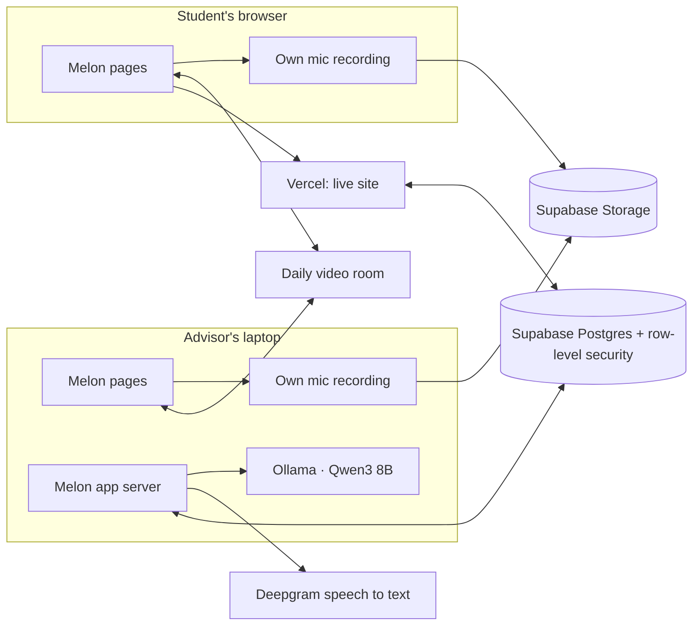

# Melon: technical brief

Melon turns every advising and career-coaching appointment into a living career roadmap. The meeting is recorded only if both people agree, the transcript becomes key points and action items, the advisor approves them, and they land on the student's roadmap. This page covers why it's built this way, how it fits together, what it costs to run, and where it goes after the MVP.

## What works today

A working prototype, live on Vercel and runnable on a laptop.

1. An advisor or coach opens a **Melon video call** from a student's appointment. The student joins from Home or Appointments.
2. **Both people agree to recording** inside the call. Either can pause it, resume it, stop it (nothing is kept) or end the meeting.
3. Each browser records **only its own microphone**, so the transcript knows exactly who said what.
4. Both people **check the transcript together**, fixing, adding or deleting lines. Every change is logged.
5. An **open-source model on the advisor's own computer** drafts the summary, key points and action items. The transcript never goes to a cloud AI.
6. The advisor reviews each item (with the transcript lines behind it), decides where each action item goes (an action item, a milestone in a chosen semester, or under a bigger goal) and approves.
7. The student sees highlights in **Appointments**, steps in **Action items**, and goals and wins on their **Roadmap**, which they accept before it's final.

## Why this stack

| Need | Choice | Why |
|---|---|---|
| Web app for students and staff, on phones and laptops | **Next.js 15** (App Router, TypeScript), **Tailwind 4** | One codebase for every screen and the server logic. Server actions keep secrets on the server. TypeScript catches mistakes before they ship. |
| Student records with strict privacy | **Supabase** (Postgres, Auth, Storage) | Privacy rules live **in the database** (row-level security), not only in the app, so a bug in a screen can't leak a student's data. Login and file storage come with it. |
| Hosting | **Vercel** | Deploys from GitHub on every merge, free for a prototype, same platform as Next.js. |
| Video calls | **Daily** (`@daily-co/daily-js`) | Reliable video on poor Wi-Fi (relay servers), private rooms with per-person tokens, embeds in our page. Free tier covers a pilot. |
| Speech to text | **Deepgram** (nova-3) | Accurate, fast (a 1-minute call is ready in 5 to 8 seconds), pay per minute. Each person's track is sent separately, so no speaker guessing. |
| Summaries | **Ollama** with **Qwen3 8B** (open source), local | Transcripts of advising sessions are sensitive. A local open model keeps them off cloud AI services. Claude is the optional cloud fallback; saved suggestions and simple rules are the last fallback, so the demo never stops. |

## Architecture

- **One database, two app servers.** The live site (Vercel) and the advisor's laptop run the same app against the same Supabase project, so a student on the live site sees what the advisor approved on the laptop. Only the AI step needs the laptop.
- **Privacy enforced where the data lives.** Students see only their own data. Students never see AI drafts, only what an advisor approved. Concerns stay staff-only. Recording needs both people's consent, which can't be edited or deleted, and a recording row is refused without it. Transcript views and edits are logged.
- **Humans decide.** Every AI suggestion links to the transcript lines behind it (one with no evidence is dropped), and the advisor approves everything. A roadmap is final only when both the advisor and the student accept it.
- **Focus by design.** At most 2 new steps per session and 5 open at once, so students aren't buried. Extra steps wait in line.

## Technical soundness

- **Tests:** 59 unit tests (resume reading, roadmap templates, step ordering, transcript merging), 9 database test files that check the privacy rules against a real Postgres, and end-to-end runs of the full loop in two real browsers with real video and speech to text.
- **12 database migrations**, run in order, so each change reaches the live database as one small, reviewable step.
- **Fallbacks at every risky step:** no speech-to-text key or a failed transcription → the sample conversation; no local model → Claude → saved suggestions → rules; a failed call → the in-person session page.

## Resources and running costs

| Piece | What it needs | Cost for the pilot |
|---|---|---|
| Supabase | One project (database, login, file storage) | Free tier |
| Vercel | One project linked to GitHub | Free (Hobby) |
| Daily | API key | 10,000 free participant-minutes a month, then $0.004 per participant-minute |
| Deepgram | API key | Pay per audio minute (about 2 participant tracks per meeting) |
| Local model | Ollama + Qwen3 8B: about 5 GB download, 16 GB of memory | Free. A summary takes about 20 seconds on a 16 GB Apple M4 (about a minute for the first one while the model loads) |
| Claude (optional) | API key | Pay per use; off by default |

A 30-minute meeting uses about 60 Daily participant-minutes, so the free tier covers about 160 meetings a month before any video cost.

## Roadmap: from MVP to product

| Phase | Milestones |
|---|---|
| **Now: MVP** (done) | Onboarding with resume autofill; roadmaps both sides accept; video calls with two-sided consent; shared transcript; local AI summaries; advisor review and placement; candy-road roadmap; staff overview and meeting prep. |
| **Next: one-semester pilot at one career center** | Booking and calendar sync (Google and Outlook); automatic deletion of audio after 30 days; school single sign-on; real email sender; student settings; accessibility review; the open model on a school-managed server instead of a laptop. |
| **Then: more schools** | Integrations with the systems schools already use (Handshake, Teams, calendar, degree planners, Canvas); career-center reporting on outcomes; per-school privacy settings and data retention; a mobile app. |

## Known limits today

- Appointments come from test data; there's no booking screen yet.
- **Add to calendar** opens a filled-in Google Calendar event; it doesn't sync.
- Audio isn't deleted automatically yet (`recordings.delete_after` is set, but no job acts on it).
- The local model runs on the advisor's laptop, so the live site alone uses the fallbacks.
- It runs on mock students and invented data only.
